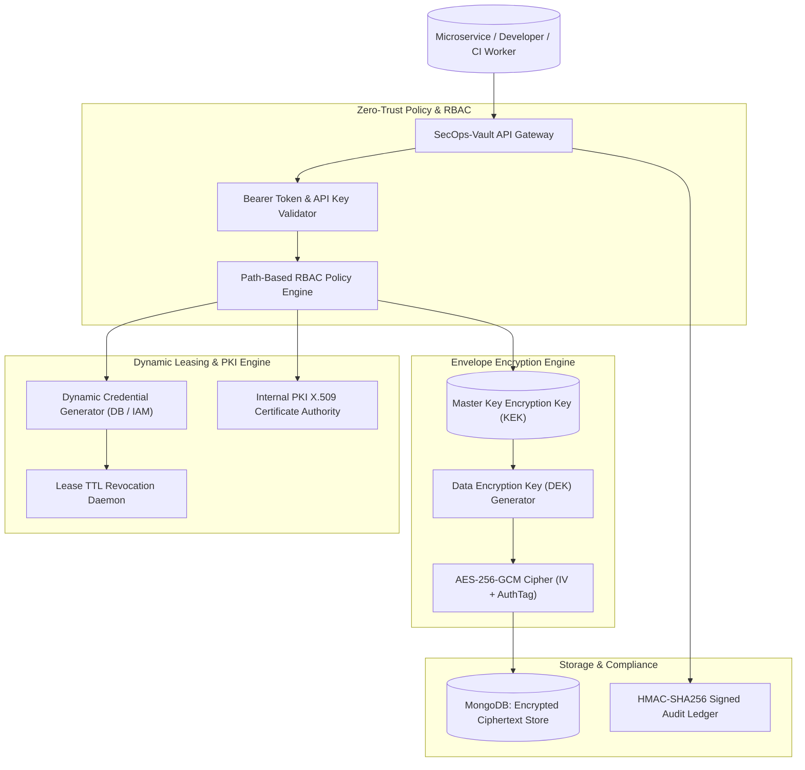

# SecOps-Vault 🛡️🔐

> **Enterprise Secret Management, Dynamic Credential Rotation, PKI Certificate Authority & Envelope Encryption Engine.**

[](https://opensource.org/licenses/MIT)
[](https://nodejs.org/)
[](https://www.docker.com/)
[](#envelope-encryption-architecture)
[](#test-suites)

SecOps-Vault is a zero-trust secret management and cryptographic orchestration platform designed to secure sensitive credentials across multi-cloud environments. It features hardware-grade envelope encryption (AES-256-GCM), short-lived dynamic database credential leases with automated revocation, an internal X.509 PKI certificate authority, and tamper-evident audit logging.

---

## 🏛️ System Architecture



---

## 🚀 Key Architectural Capabilities

1. **Envelope Encryption Architecture**: Protects sensitive payloads using two layers of keys: a unique Data Encryption Key (DEK) encrypts the plaintext payload via authenticated `AES-256-GCM`, and a Master Key Encryption Key (KEK) wraps the DEK.
2. **Short-Lived Dynamic Credentials**: Generates ephemeral database users and access tokens on-demand with strict Time-To-Live (TTL) limits, automatically revoking credentials upon expiration to eradicate permanent credential compromise.
3. **Internal PKI Certificate Authority**: Provides automated issuance, renewal, and revocation of TLS/X.509 certificates for secure service-to-service mutual TLS (mTLS) communication.
4. **Zero-Downtime Secret Rotation**: Automatically cycles encryption keys and database passwords on a scheduled interval while maintaining multi-version key history for backward compatibility.
5. **Path-Based Role-Based Access Control (RBAC)**: Fine-grained access control policies matching paths (e.g. `secret/data/production/*` restricted to authorized administrators).
6. **React 18 SecOps Operations Console**: Trader-grade terminal displaying active dynamic leases, secret path hierarchies, certificate expiry meters, and HMAC-signed audit streams.

---

## 📦 Directory Structure

```text
secops-vault/
├── client/                     # React 18 SecOps Operations Console
│   ├── public/
│   │   └── index.html
│   └── src/
│       ├── components/         # Visualizer, Metrics, Leases, Secret Table
│       ├── services/           # REST API client
│       ├── utils/              # Time and cryptographic formatters
│       ├── App.jsx             # Main interactive dashboard
│       ├── App.css             # High-density dark theme styling
│       └── index.js            # React root mount
├── server/                     # Core Vault Security Engine
│   ├── config/                 # Constants, DB, and encryption parameters
│   ├── controllers/            # Secret, Lease, PKI, Analytics
│   ├── middleware/             # Auth, RBAC, rate limiting, error handling
│   ├── models/                 # VaultSecret, DynamicLease, PkiCertificate, etc.
│   ├── routes/                 # Express REST endpoint declarations
│   ├── services/               # EnvelopeEncryption, DynamicCredentials, PKI
│   ├── tests/                  # 7 Comprehensive Automated Test Suites
│   ├── utils/                  # Structured logger & vault seeder
│   └── server.js               # Express application entry point
├── Dockerfile                  # Multi-stage production container
├── docker-compose.yml          # Containerized MongoDB, Redis & API stack
├── CHANGELOG.md                # Release history
└── package.json                # Project dependencies & scripts
```

---

## ⚡ Quick Start

### Prerequisites
- Node.js >= 18.0.0
- MongoDB >= 6.0
- Docker & Docker Compose (optional)

### Local Development Setup

```bash
# 1. Clone repository
git clone https://github.com/developertdsl-prog/secops-vault.git
cd secops-vault

# 2. Install dependencies
npm install

# 3. Configure environment variables
cp .env.example .env

# 4. Seed initial Master KEK, secret paths, and certificates
npm run seed

# 5. Run automated test suites
npm test

# 6. Launch development server and terminal console
npm run dev
```

---

## 📡 REST API Reference

| Endpoint | Method | Description |
| :--- | :--- | :--- |
| `GET /api/v1/ping` | GET | Health verification and system status |
| `GET /api/v1/secrets/*` | GET | Read and decrypt secret at specified path |
| `POST /api/v1/secrets/*` | POST | Write new encrypted secret with version tracking |
| `DELETE /api/v1/secrets/*`| DELETE | Soft-delete or purge secret at specified path |
| `POST /api/v1/leases/:id/renew`| POST | Extend TTL of active dynamic credential lease |
| `POST /api/v1/leases/:id/revoke`| POST | Revoke dynamic credential immediately |
| `POST /api/v1/pki/issue` | POST | Generate and sign new X.509 TLS certificate |
| `GET /api/v1/analytics/summary`| GET | Total secrets, active leases, and audit metrics |

---

## 🧪 Automated Test Suites

SecOps-Vault includes 7 rigorous automated test suites:

- `envelopeEncryption.test.js`: Validates AES-256-GCM authenticated encryption, random IVs, and tag matching.
- `dynamicCredentialManager.test.js`: Validates dynamic credential generation, TTL expiration, and renewal bounds.
- `pkiCertificateAuthority.test.js`: Validates certificate issuance, serial numbers, and validity dates.
- `secretRotation.test.js`: Validates secret versioning and zero-downtime rotation.
- `vaultRbac.test.js`: Validates path-based role access policies and rejection of unauthorized callers.
- `secretController.test.js`: Validates CRUD secret endpoints and HTTP status codes.
- `e2eSecOpsVaultWorkflow.test.js`: End-to-end integration test from secret write to decryption and audit signing.

---

## 📄 License
This project is licensed under the MIT License - see the [LICENSE](LICENSE) file for details.
